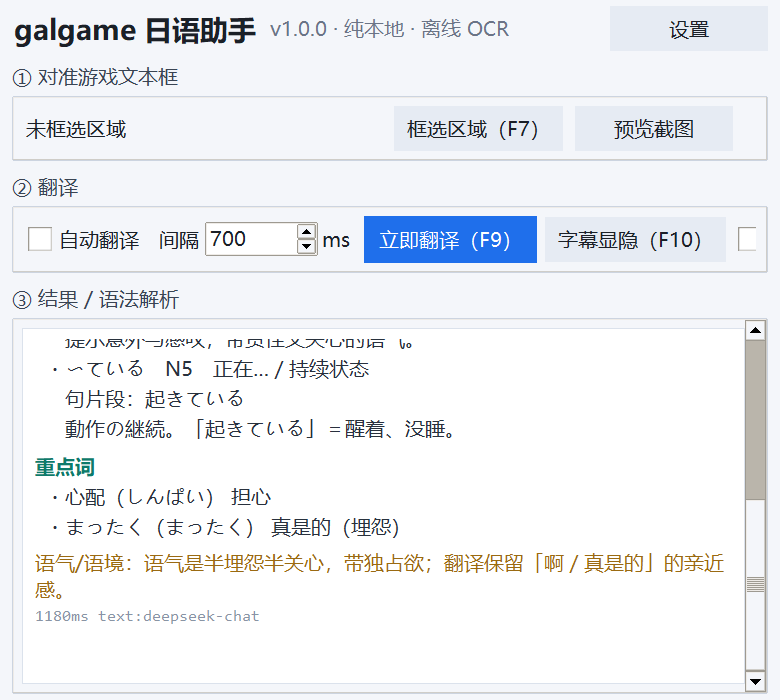
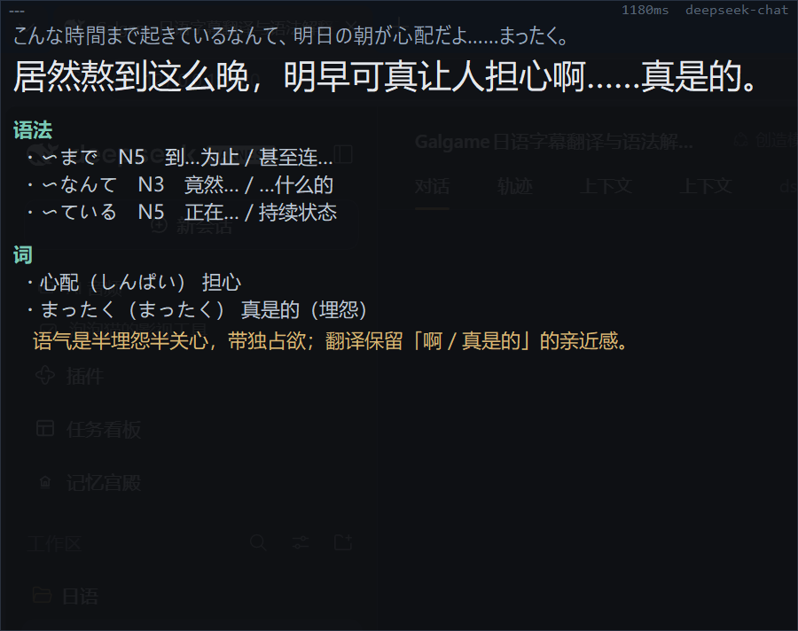
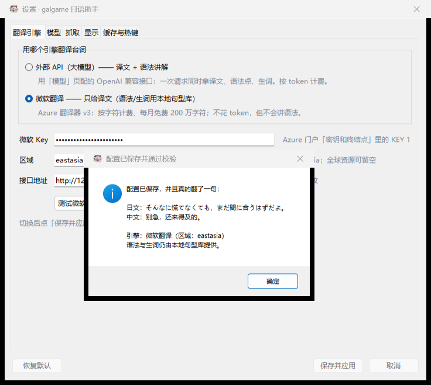

# 你还在为啃生肉而烦恼吗

## 一边学日语和玩galgame的有福了

**生肉锅（Nikunabe）** —— 玩 galgame 时把日语字幕框住，程序自动认出日文 → 译成中文 → 顺手把这句话里的**语法点**和**生词**讲明白。啃生肉不用查词典，也不用切出去搜语法。

截图与文字识别**全在本机**（Windows 自带日语 OCR 引擎，不联网）；只有「翻译 + 讲解」这一步会调用你自己填的大模型接口（DeepSeek / OpenAI / 本地 Ollama / 任意 OpenAI 兼容服务）。没填 Key 也能用：内置 118 条句型 + 143 个高频词，离线标出语法与生词。

<p align="center">
  
  
</p>

**下载**：[Releases](../../releases)（每个版本都挂 zip；Release 说明就是该版本的更新日志）
　**更新日志**：[CHANGELOG.md](CHANGELOG.md)

## 这个项目是干什么的（用途）

| 你在干什么 | 它帮你做什么 |
| --- | --- |
| 啃生肉 galgame，日语半懂不懂 | 对话框一换台词，中文译文就贴在游戏下方，秒级跟上 |
| 想顺便学日语，但语法书太枯燥 | 每句台词标出命中的句型（N5~N1）、接续与讲解，外加生词读音与释义 |
| 不想被翻译打断沉浸感 | 悬浮条可拖动、可穿透鼠标、F10 一键隐藏；主窗口留完整讲解 |
| 嫌在线翻译太贵 / 断网也能看 | 离线层先给你「这句子用了什么语法、哪些词是关键」，模型层到了再补中文 |
| 用别的语言/别的引擎 | OCR 引擎、模型接口、抓取方式（截图 OCR / 剪贴板 / 多模态直读）都可换 |

一句话：**把「看日语」变成「看得懂 + 学得会」。**

## 它能做什么

- **框一次，后面全自动**：F7 框住对话框，之后每 0.4~0.8 秒自动看一眼；读到新台词才翻译，同一句不重复花钱。
- **翻译 + 语法点**：输出中文译文、命中句型（N5~N1 难度、接续、讲解）、生词（读音+释义）、语气/语境点评。
- **本地语法兜底（两层输出）**：第一层离线（118 条句型 + 143 个高频词）**和译文同一帧出现**，不联网不花钱；第二层由模型流式讲解，第一条约 2.5 秒到，之后每 0.3~0.4 秒长出一条。
- **覆盖原文（F11）**：把中文译文直接盖在日文台词上，位置和游戏对话框对齐、底色取自对话框本身，看上去就是官方中文版；游戏文件一个字节都不动，再按一次 F11 就还原。
- **贴屏悬浮窗**：浮在游戏画面上方，可拖动、滚轮改字号、F6 鼠标穿透、F10 一键隐藏；压到识别区会自动让开。
- **三种抓取方式**：截图 OCR（默认，最通用）、剪贴板、多模态模型直读图片。

## 怎么用（下载 → 三步上手）

从 [Releases](../../releases) 下载 `galgame-jp-helper-v1.1.1-win64.zip`，解压到任意目录（**不要放在 C:\Program Files 里**，那里写不了配置；真放进去了程序会自动把配置改存到 `%LOCALAPPDATA%\galtl`），双击 `galgame日语助手.exe`。

不需要装 Python、不需要 pip。单文件约 33MB。

```bat
galgame日语助手.exe            双击即用
galgame日语助手.exe --check    环境自检（OCR / 模型 / 悬浮窗拖动），结果写到同目录 selfcheck.txt
```

装好 OCR 语言包后：**F7 框对话框 → 设置里填模型与 Key → 勾「自动翻译」→ 继续玩**。细节见下面「三步上手」。

## 系统要求

| 项 | 要求 |
| --- | --- |
| 系统 | Windows 10 1809+ / Windows 11，64 位 |
| 组件 | PowerShell 5.1（系统自带）、.NET Framework 4.x（系统自带） |
| **日语 OCR 语言包** | **必须安装**，见下一节；没装会在状态栏/日志里明确告诉你 |
| 网络 | 只有「翻译+讲解」需要，可换成局域网/本机的 OpenAI 兼容服务 |
| 显卡 | 无要求（OCR 是 CPU 走的 Windows 引擎） |

### 一、装日语 OCR 语言包（最重要的一步）

第一次运行如果看到「这台电脑的 Windows OCR 没有「ja」语言包（已装：…）」，按下面任一种装：

**方式 A：图形界面**

Win11：设置 → 时间和语言 → 语言和区域 → 添加语言 → 搜「日本語」→ 安装 → 装好后点它的「语言选项」→ 勾选 **光学字符识别（OCR）**。
Win10：设置 → 时间和语言 → 语言 → 添加首选语言 → 日本語 → 装好后进「选项」→ 勾选 **光学字符识别**。

**方式 B：管理员 PowerShell 一条命令**

```powershell
Add-WindowsCapability -Online -Name "Language.OCR~~~ja-JP~0.0.1.0"
```

**验证**：管理员运行 `galgame日语助手.exe --check`，`selfcheck.txt` 里应该出现

```
OCR 引擎 lang=ja 可用语言=['en-GB', 'ja', 'zh-Hans-CN']
```

`可用语言` 里出现 `ja` 就成了（其它语言是系统自带的，不影响）。

## 三步上手

1. 打开游戏到有对话的画面 → 按 **F7** → 只框**对话框**那一块。
   （别框整屏：整屏一帧要 1.5~3 秒，1300×300 的对话框约 0.2 秒。程序会按 `ocr_pixel_budget` 自动收缩放大倍数，但根本解法是框小。）
2. 「设置 → 模型」填 `base_url`（如 `https://api.deepseek.com/v1`）、`model`、`api_key`。
3. 勾「自动翻译」（或按 F8）→ 玩。译文与语法讲解出现在悬浮窗和主窗口③区。

没有 API Key 也能先玩玩：离线语法库会标出句子里命中的句型，只是没有中文译文。

## 两个翻译引擎（设置 → 翻译引擎）

翻译走哪条路可以自己选，两条都留了：

| 模式 | 谁来翻 | 拿到什么 | 花钱方式 | 适合谁 |
| --- | --- | --- | --- | --- |
| **外部 API（大模型）** | 你在「模型」页配的 OpenAI 兼容接口（DeepSeek / 通义 / Kimi / 本地 Ollama 都行） | 译文 **+** 语法点、重点词、语气说明 | 按 token 计费 | 想边玩边学语法 |
| **微软翻译** | Azure 翻译器 v3（`translate?api-version=3.0`） | **只给译文**；语法/生词取本地句型库 | 按字符计费，每月免费 200 万字符 | 只想看懂剧情、不想花 token |

微软翻译这条要在 Azure 里建一个「翻译器」资源，把「密钥和终结点」页里的 **KEY 1** 填进设置的「微软 Key」：

- **区域**（`ms_region`）填资源所在区域，如 `eastasia`、`japaneast`；**全球资源**（Global）留空。
- 免费层 F0：每月 200 万字符，日语短句足够玩很久；超了会返回 429，程序会提示「等一会儿或把自动翻译间隔调大」。
- 接口地址一般不用改（`https://api.cognitive.microsofttranslator.com`），要走代理/镜像时改 `ms_endpoint`。
- 填完点「测试微软翻译」，能在下面看到译文就说明通了。

切换是**即时生效**的（点「保存并应用」后），缓存两边共用：同一句台词不会因为换了引擎再花一次钱。没有 key 时两条路都退化成「本地句型库 + 不翻」——不会报错卡住。

### 点「保存并应用」会当场校验

配置先落盘，然后立刻**真连一次接口**翻一句 `そんなに慌てなくても、まだ間に合うはずだよ。`：

- 通了 → 弹**成功框**，里面就是刚才的真实译文（微软模式写清用的哪个区域；`llm` 模式还会报告「语法 N 条、重点词 M 个」）；
- 完全没填 key → 弹**提示框**，说明现在只有本地句型库、key 该去哪抄（Azure 门户的 KEY 1 / 「模型」页的 API Key），配置照样保存；
- `401/403`、地址写错、模型名空 → 弹**错误框**，把下一步写进正文（重抄 KEY 1、base_url 要填到 `/v1` 结尾…）。

顺便体检几个容易配错的值（自动翻译间隔 < 100ms、放大倍数不在 1.0~3.0、`min_ratio` 不在 0.1~0.9、上文条数 > 6、还没用 F7 框选区域），只提醒、不改你填的值。校验在后台线程里跑，网络慢也只是按钮变灰、底部显示「正在校验配置…」，窗口不会「未响应」。



设置窗口会按内容自动定尺寸，「保存并应用 / 取消 / 恢复默认」固定贴在窗口底部，打开就能看到，不用手动拉大；屏幕实在放不下时页签会自带滚动条。

## 覆盖原文（像官方中文版那样玩）

不想读旁边的字幕条，只想让画面里就是中文：

1. **F7** 框住对话框里的**文字那一块**（不必框整个对话框，只框字所在的高度就好）。
2. 点主窗口的 **「覆盖原文」**，或直接按 **F11**。
3. 第一次会先抓一次识别区取底色，之后中文就盖在日文原来的位置上；再按 **F11** 立刻还原。

几个细节：

- **它不会影响识别**：盖上去的窗口对「屏幕捕获」不可见（`WDA_EXCLUDEFROMCAPTURE`），所以程序自己截屏拿到的仍是背后的日文，换句检测和自动翻译照常工作，不会「自己读自己」。
- **盖住的地方照样能点**：默认点击穿透，存档/选项/快进都能按；想拖动这块中文，按 `F6` 关掉穿透再拖。
- **可以调**：设置里能改底色 `cover_bg`、字色 `cover_fg`、不透明度 `cover_alpha`（默认 1.0，想透一点就看得到底下的日文）；**字号默认跟原文一样大**（每帧 OCR 顺手量出原文字高再反推字号，不用手动调，想微调就动 `cover_size_ratio`）、是否自动取底色 `cover_match_bg`。
- 老系统不支持那条 API 时，程序在取样的那一瞬间会把自己藏起来再截图，仍然不会读到自己的译文。

## 热键

| 键 | 作用 |
| --- | --- |
| F7 | 框选字幕区域 |
| F8 | 自动模式 开/关 |
| F9 | 立即翻译一次 |
| F10 | 悬浮字幕 显示/隐藏 |
| F11 | 覆盖原文 开/关（把中文直接盖在日文台词上） |
| F6 | 悬浮字幕 鼠标穿透 开/关（穿透后按住 Ctrl 仍可拖动） |

悬浮窗上：拖动 = 移动（位置会记住），滚轮 = 改字号，右键 = 菜单（位置重置 / 设置 / 隐藏）。

## 配置（`config.json`，与 exe 同目录）

界面里能改的都在「设置」里；也可以直接编辑 JSON，改完重启生效。

**抓取**

| 键 | 默认 | 说明 |
| --- | --- | --- |
| `mode` | `ocr` | `ocr` 截图识别 / `clipboard` 读剪贴板 / `vision` 多模态模型直读图 |
| `region` | `[0,0,0,0]` | 屏幕坐标 x,y,w,h（F7 框完自动写入） |
| `poll_ms` | `250` | 轮询间隔（毫秒）。每次只回读一张 64×16 的小帧用来判断画面变没变 |
| `use_probe` | `true` | 先比小帧再决定要不要 OCR（省掉大量无用识别） |
| `probe_min_change` | `0.02` | 空闲时：画面变化占比低于此值就不 OCR（滤掉闪烁 ▼、呼吸立绘） |
| `probe_min_change_active` | `0.002` | 刚翻页/待确认时的小阈值，保证「ん」「っ」这种短句不被当成噪声 |
| `only_foreground` | `true` | 识别区所属窗口不在前台时完全不抓屏（省 CPU，也不会把别的窗口文字当台词） |
| `idle_after_ticks` | `8` | 连续多少轮台词没变算「空闲」（约 2 秒） |
| `idle_poll_ms` | `450` | 空闲时的轮询间隔 |
| `stable_reads` | `2` | 需要几次一致的画面才翻译，防半帧闪现/重影（2 = 看一眼确认） |
| `upscale` | `2.0` | 识别前放大倍数，小字游戏有用 |
| `ocr_pixel_budget` | `3000000` | 像素预算：放大倍数自动收缩到这个规模内，避免大框选拖慢速度 |
| `binarize` | `false` | Otsu 二值化，花屏/低对比时可开 |
| `min_ratio` | `0.35` | 日文字符占比阈值，低于此视作 UI 噪声 |
| `stream_translate` | `true` | 译文边生成边显示（首字通常 0.3~0.8 秒出来） |
| `grammar_phase` | `true` | 两段式：先出译文，语法/生词第二段补上 |
| `grammar_async` | `true` | 第二段放后台线程，不堵住下一句台词 |
| `translate_max_tokens` | `240` | 第一段（译文）的输出上限 |
| `grammar_max_tokens` | `520` | 第二段（语法讲解 JSON）的输出上限 |
| `grammar_first_timeout` | `12.0` | 讲解首条超过这么多秒还没来，就整段重发一次 |
| `grammar_total_timeout` | `40.0` | 讲解整体最多等这么久，避免卡死 |

**语法与生词是「两层」的**

| 层 | 来源 | 什么时候出现 | 说明 |
| --- | --- | --- | --- |
| 第一层（离线） | `galtl/grammar.py` 118 条句型 + `galtl/vocab.py` 143 条高频词 | 与译文**同一帧**（实测 0.03~0.07 毫秒） | 不联网、不花钱，先给你能看的东西 |
| 第二层（模型，流式） | `llm.analyze_grammar_stream` | 首条约 2.5 秒，之后每 0.3~0.4 秒一条 | 一行一个 JSON 对象，解析出一条就上屏一条 |

讲解请求与翻译**并行**发出（讲解只需要日文台词，不用等译文），所以第二层通常在你读第一层时就已经在路上。流式过程中界面只增不减；如果一条都没解析出来，会自动退回整段 JSON 请求，讲解不会丢。

同一句台词在「闪烁光标、淡入动画」下会有一两个字的差别：`galtl/textutil.py::similar_key` 先判定「是不是同一句」（去标点空白后的相似度、包含关系、共同连续片段 ≥8 字或共同结尾 ≥6 字且长度比 ≥0.5），判成同一句就只花一次钱。更关键的是**库里一句话只留一个「正身」**：`cache.db` 的 `aliases` 表把同一句的其它读法都登记成别名，`get()` 顺着别名解析到正身取译文，`put()` 遇到已有正身的句子只续命、不再存第二份。所以即使 OCR 把 `電車を降りて…` 读成 `~・ユ降りて…`，屏幕上也只有一套译文——这正是 1.1.7 修掉「同一句在两套译文之间闪」的办法。启动时还会跑一次 `Store.compact()`，把历史上攒下的重复读法并成一个正身。

**OCR 引擎**

| 键 | 默认 | 说明 |
| --- | --- | --- |
| `ocr_engine` | `winocr` | `winocr` Windows 内置引擎 / `tesseract` |
| `ocr_lang` | `ja` | winocr 语言标签（`ja` / `ja-JP` 都行） |
| `tesseract_exe` / `tesseract_lang` | `tesseract` / `jpn` | 用 tesseract 时的可执行文件与语言包 |

**模型**

| 键 | 默认 | 说明 |
| --- | --- | --- |
| `translate_engine` | `llm` | `llm`=外部 API（译文+语法）／`ms`=微软翻译（只给译文，语法用本地库） |
| `provider` | `deepseek` | 仅作标记，实际看 `base_url` |
| `base_url` | `https://api.deepseek.com/v1` | OpenAI 兼容地址，**以 `/v1` 结尾** |
| `model` | `deepseek-chat` | 文本模型名 |
| `api_key` | 空 | **只存在本机 `config.json`**，不会上传 |
| `vision_model` | 空 | `mode=vision` 时用的多模态模型名 |
| `temperature` / `max_tokens` / `timeout` | `0.3` / `1200` / `60` | 采样与超时 |
| `extra_headers` | `{}` | 附加请求头，例如 `{"HTTP-Referer": "..."}` |
| `glossary` | 空 | 术语表，逐行 `日文=中文`（人名、专有名词统一译法） |
| `context_lines` | `2` | 带上几条前文当上下文 |
| `auto_translate` | `false` | 启动即开自动模式 |

**微软翻译**（`translate_engine=ms` 时才用）

| 键 | 默认 | 说明 |
| --- | --- | --- |
| `ms_key` | 空 | Azure 翻译器资源的 KEY 1，**只存在本机 `config.json`** |
| `ms_region` | 空 | 资源区域，如 `eastasia`；全球资源留空 |
| `ms_endpoint` | `https://api.cognitive.microsofttranslator.com` | 要走镜像/代理时改这里 |
| `ms_from_lang` / `ms_to_lang` | `ja` / `zh-Hans` | 源语言 / 目标语言 |

**悬浮窗**

| 键 | 默认 | 说明 |
| --- | --- | --- |
| `overlay_pos` / `overlay_width` | `[0,0]` / `1100` | 位置与宽度（`[0,0]` = 自动底部居中） |
| `overlay_alpha` | `1.0` | 不透明度（配合下面的背景开关） |
| `overlay_bg_transparent` | `false` | `true` = 只留文字、背景透出游戏画面；`false` = 实心底板（默认） |
| `jp_size` / `zh_size` / `gram_size` | `12` / `19` / `11` | 原文/译文/讲解字号 |
| `show_jp` / `show_kana` / `show_vocab` / `show_notes` | `true` / `false` / `true` / `true` | 悬浮窗显示哪些行 |
| `overlay_locked` / `overlay_visible` | `false` / `true` | 鼠标穿透 / 是否显示 |
| `anim_enabled` / `anim_ms` | `true` / `160` | 流式上屏与换字的淡入动画；关掉就是直接跳出来（远程桌面、老机器建议关） |
| `font_jp` / `font_zh` | `Yu Gothic UI` / `Microsoft YaHei UI` | 字体 |
| `theme` | `dark` | `dark` / `light` |

**覆盖原文**

| 键 | 默认 | 说明 |
| --- | --- | --- |
| `cover_mode` | `false` | 是否开启覆盖原文（F11 切换） |
| `cover_match_bg` | `true` | 自动取游戏对话框底色；关掉则用 `cover_bg` |
| `cover_bg` / `cover_fg` | `#0b0f16` / `#ffffff` | 底色 / 字色（`cover_match_bg=true` 时底色以取样为准） |
| `cover_alpha` | `1.0` | 不透明度；调小会透出底下的日文 |
| `cover_match_size` | `true` | 中文按**原文实测字高**定字号，跟日文同一比例；关掉则尽量撑满文字带 |
| `cover_size_ratio` | `1.0` | 在上面基础上微调大小（1.1 略大，0.9 略小） |
| `cover_max_size` / `cover_min_size` | `30` / `12` | 仅 `cover_match_size=false` 时作为字号上下限 |
| `cover_capture` | `"exclude"` | 覆盖层对截屏/录制的可见性：`exclude` 常驻隐藏（自己玩最稳）；`record` 平时可见、只在取词瞬间隐藏（**NVIDIA / OBS 录制能录到中文**）；`off` 永不隐藏（老系统兜底） |
| `cover_exclude_capture` | `true` | 旧键，等价于 `cover_capture="exclude"`；为 `false` 时启动会自动迁移成 `off` |
| `cover_click_through` | `true` | 盖住的地方是否让鼠标穿透到游戏 |

**缓存与热键**：`use_cache`（同句不重复请求）、`cache_ttl_days`（0=永久）、`hotkeys`（全局热键开关）。

## 常见问题

- **Windows 弹「已保护你的电脑」/ 杀软报毒**：单文件 PyInstaller 程序常见误报（它会在临时目录解包自身）。点「更多信息 → 仍要运行」，或把 exe 加进白名单。想避开误报可以用源码运行，或自行按下面的方法重新打包。
- **一直「没有文字」**：框选区偏了，或游戏是独占全屏（改成「无边框窗口」）。重按 F7 只框文字区；`min_ratio` 调到 0.2；白字发虚就开 `binarize`、`upscale` 调到 2.5。
- **译文和原文对不上 / 只翻了半句**：台词逐字弹出时程序抢跑了。调大 `settle_ms`（默认 200ms，慢速打字机设 350），它会等这句话停下再翻；`stable_reads` 调到 2~3 更稳。
- **按 F11 中文没盖住日文**：先确认识别区（F7）框的是对话框文字区——覆盖层只会贴在这块上；再点主窗口的「覆盖原文（F11）」复选框，状态栏会说明当前状态。开了以后覆盖层**对截图不可见**（`WDA_EXCLUDEFROMCAPTURE`），所以用截图工具看不出来是正常的，肉眼才看得到。
- **识别一帧要好几秒**：`region` 框太大了，见上面的性能说明。
- **模型 401**：`api_key` 或 `base_url` 不对（要 `/v1` 结尾）；设置里有「测试连接」会打印原始报错。
- **自动翻译不触发、只有按 F9 才翻**：多半是字幕条压在识别区上——截图会把字幕条自己的译文一起 OCR 回去，文本每帧都变，程序判不出「这句已经稳定」。1.0.7 起字幕条会自己躲开识别区（框选后与每次启动时自动挪到识别区外并记住位置）；若识别区大得无处可躲（例如框了整屏），按 F7 只框对话框文字即可。
- **字幕条挡住游戏 / 拖不动**：F10 隐藏、F6 穿透；拖动标题栏或文字区都能移动，松手即记住位置，右键菜单可「位置重置」。
- **用 NVIDIA / OBS 录制时录不到中文（或录出来是黑块）**：默认的 `exclude` 档会让覆盖层对所有截屏与录制隐身，这是故意的（不然 OCR 会把自己的中文读回去、画面也会闪）。打开**设置 → 显示 → 覆盖原文与录制**，把「截图可见性」改成 `record`：平时可见、只在取词那一瞬间隐藏，取完立刻恢复，录出来的视频里有中文、也不会闪。改完立刻生效，不用重启。
- **覆盖原文里出现了好几行 / 只有半句**：1.0.9 起已修。多行是模型「顺手把上文也翻了」，现在上文按对话历史传入、只翻最后一句，并有一道单行兜底；半句是流式传输中途断掉，现在断流的半句只显示不缓存，不会一直卡着。如果还遇到，把 `galtl.log` 里 `译文流中断` 那行发我。
- **覆盖原文盖不住 / 位置偏了**：F7 重新只框**文字那一带**（文字上下各留一点余量）；改了窗口大小或游戏切分辨率后也要重框一次。想让中文透出一点日文，把 `cover_alpha` 调到 0.9 左右。
- **译文和原文对不上、语法讲了个句子里没有的句型**：1.0.10 起已修两类——`ってば／ったら` 不再被当成「〜ば（假定形）」或「〜ては」讲（它其实是催对方听的终助词，译「我说…啊」「喂，你倒是…」）；模型报的语法点必须在原句里对得上 `form`，纯名词也不会再占一栏语法。
- **汉化版游戏（台词已经是中文）**：1.0.10 起，识别到的文本**没有假名**就当噪声跳过，不调用模型、不显示，也不会花钱；纯汉字的日语短句（`無理`、`了解` 等）仍在白名单里照常翻。
- **屏幕上出现「任务栏、调用指令、@文件或对话」「用时 11 分 57 秒……」这类译文**：1.0.17 起不再翻这些——它们不是游戏台词，而是 OCR 把任务栏/聊天窗口/报错弹窗读进来了。程序会判成噪声跳过，并在状态栏提示「按 F7 只框对话框文字区」。如果频繁出现，说明识别区里混进了对话框以外的东西，重框一次即可。
- **译文突然变成「这看起来不是日文台词…我无法翻译」**：这是模型在推脱，1.0.17 起会直接丢弃、不入库，并提示「这一帧没认出日文台词」；老版本留下的这类脏缓存会在升级后自动清掉。
- **只有一个小假名的台词（「ん」「っ」「あ」）没反应**：Windows 自带的日文 OCR 对单字台词一律返回空（换字体、字号、黑白配色都一样，见 `single_kana_check.py`），这是引擎硬限制。1.1.3 起改走**字形模板匹配**：把画面裁到那一个墨迹，跟系统字体渲染的假名表比对；认不准就不翻，绝不猜。想关掉把 `glyph_fallback` 设为 `false`。
- **字幕条的字一个一个往外蹦、还掉帧**：1.1.4 起已改。原来每来一个增量就把文本框整个重建、还搬两次窗口（量一次高度、摆一次位置），一次增量就是「删全文 + 重排 + 两次 `SetWindowPos`」。现在是**只往句尾追加**新字、高度变化 ≤2px 就不动窗口、流式过程中只长不缩，换字改成淡入。实测每字渲染 **4.88ms → 0.44ms**。想彻底关掉动画（远程桌面/老机器）：`anim_enabled` 设 `false`。
- **双击没反应**：跑一次 `galgame日语助手.exe --check`，看同目录 `selfcheck.txt` 与 `galtl.log`（UTF-8，1MB 轮转）。日志里「抓取失败 / 引擎错误」后面的原始异常就是根因。
- **配置存哪**：优先 exe 同目录；目录不可写时自动改用 `%LOCALAPPDATA%\galtl`（`--check` 会打印实际路径）。

## 数据与隐私

- 截图只在内存里传给本机 PowerShell OCR 进程，**不落盘、不联网**。
- 识别出的日文、前文上下文、你的术语表会发给你配置的模型接口（默认 DeepSeek），仅此而已。
- `api_key` 只写在本机 `config.json`；历史与缓存是不含 key 的 SQLite（`cache.db`）。
- 仓库里不含任何 key：`config.json`、`cache.db`、`*.log` 都在 `.gitignore` 里。

## 从源码运行 / 自行打包

```bat
run.bat            :: 后台启动（无黑框）
run.bat console    :: 带控制台启动，实时看日志
run.bat selftest   :: 只做环境自检
build.bat          :: 重新打包 → dist\galgame日语助手.exe
```

源码运行要求 Python 3.10+（Tk 自带；`numpy` 可选，装了缩放/二值化更快；打包需要 `pyinstaller` 与 `pillow`）。

推送 tag（`v*`）时 GitHub Actions 会自动在 `windows-latest` 上构建 exe 并挂到 Release（见 `.github/workflows/build.yml`），所以别人 clone 下来也能自己出包。

自检/回归脚本（都不花钱、不依赖桌面内容）：

| 脚本 | 用途 |
| --- | --- |
| `selftest.py` | 环境自检：Python / DPI / OCR 引擎 / 模型 / 语法库 |
| `e2e_check.py` | 端到端：造图 → 截屏识别 → 清洗，用已知文本对照 |
| `mock_llm_check.py` | 假模型跑通翻译+解析全链路 |
| `grammar_falsepos_check.py` | `ってば` 不被误报成 `〜ば/〜ては`；模型瞎报的语法点被过滤 |
| `close_race_check.py` | 自动模式中途关窗口不刷告警 |
| `overlay_drag_check.py` | 拖完再渲染一帧位置不弹回 |
| `overlay_occlusion_check.py` | 字幕条压在识别区上时会读到自己 / 涂黑丢字 / 自动避让（三组对照） |
| `latency_check.py` / `latency_e2e.py` | 把延迟拆成指纹/OCR/首字/译文/语法逐段计时 |
| `perf_gate_check.py` | 小帧指纹、前台门（不在前台不抓屏）、空闲放慢、小面积闪烁不触发 OCR |
| `fake_game.py` | 假 galgame 对话框（台词 + 闪烁 ▼，每 4 秒换句），配合真 exe 看自动翻译 |
| `llm_parse_check.py` | 模型输出截断/代码块/尾逗号都能出结果 |
| `api_check.py` | 真实接口联通（用你 `config.json` 里的 key 翻一句） |
| `config_merge_check.py` | 外部手改 `config.json` 不会被程序 save() 冲掉 |
| `ui_preview.py` | 离屏渲染界面截图 → `docs/*.png` |

## 目录结构

```
main.py                入口（python / pythonw / exe --check）
run.bat / build.bat    启动器 / 打包脚本
make_icon.py           生成 assets\app.ico
config.example.json    配置模板
docs\                  截图
galtl\
  app.py               启动流程：DPI、日志、自检、主循环
  config.py            默认配置与读写（写盘前与磁盘合并）
  paths.py             数据目录、临时目录、打包后资源定位
  winapi.py            截屏（BitBlt/PrintWindow）、DPI、全局热键
  ocr.py               OCR 客户端：内存 PNG → worker → 识别行
  ps\ocr_worker.ps1    WinRT OCR worker（PowerShell 常驻）
  textutil.py          行合并、日文清洗、去重
  grammar.py           118 条句型库 + 匹配器（离线兜底）
  llm.py               OpenAI 兼容客户端：翻译 + 语法 JSON 解析
  pipeline.py          引擎：抓 → 识别 → 稳定判定 → 翻译 → 缓存
  store.py             历史与缓存（SQLite）
  ui_main.py / ui_overlay.py / ui_region.py / ui_settings.py / uiicon.py
```

## 免责声明

- 本项目只是**屏幕取字 + 翻译**工具，不修改、不注入、不分发任何游戏文件；请自行确保你玩的游戏是合法获得的正版。
- 程序图标取自作者本机安装的《魔女的夜宴》快捷方式图标，仅作个人使用；**该图标版权归原厂（ゆずソフト）所有**，如需公开发布请换成自己的图标（`make_icon.py` 在找不到游戏图标时会退回自绘图标，也可自行替换 `assets\app.ico`）。
- 翻译与语法讲解由第三方大模型生成，可能有错，仅供参考。

## 许可证

[MIT](LICENSE) © 2026 YG
